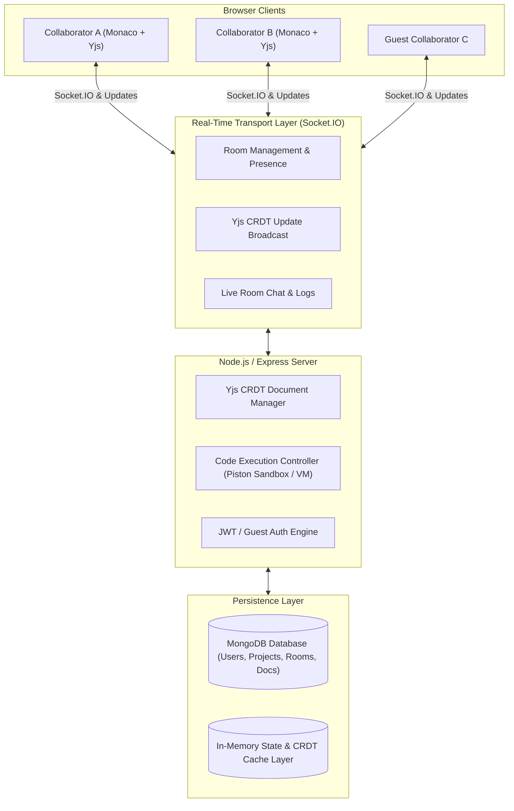

# SyncCode — Real-Time Collaborative Code Editor (MERN + Yjs CRDT + Monaco)

A production-minded, high-performance **Real-Time Collaborative Code Editor Web Application** built with the MERN stack, Yjs CRDT (Conflict-Free Replicated Data Types), Monaco Editor, Socket.IO, and Tailwind CSS.

---

## 🌟 Key Features

### 1. ⚡ Mathematical CRDT Real-Time Collaboration (Yjs)
- **Decentralized Conflict-Free Merging:** Edits are modeled as commutative CRDT operations with Yjs. Concurrent edits from multiple users merge deterministically without central server locks or lost keystrokes.
- **Bi-directional Socket.IO Transport:** State vectors and missing updates are synchronized upon room entry and broadcasted incrementally.
- **Resilient Reconnection:** Reconnection automatically catches up with document changes.

### 2. 👥 Live User Presence & Colored Carets
- **Remote Cursors & Selection Highlighting:** Collaborators see real-time cursor carets, line positions, and text selections.
- **Collaborator Badges & Custom Colors:** Each collaborator is assigned a unique color with live hover badges and active presence indicators.

### 3. 💻 Monaco Editor Integration (`@monaco-editor/react` & `y-monaco`)
- Syntax highlighting for JavaScript, TypeScript, Python, C++, Java, HTML, CSS, JSON, and Markdown.
- Minimap toggle, customizable font size (12px–24px), tab indentation (2/4 spaces), word wrap, and themes (`vs-dark`, `light`, `hc-black`).
- Download file, copy code, and instant format capabilities.

### 4. 📁 Multi-File Project Explorer
- Create, rename, switch, and delete multiple files within a project or room.
- Each file maintains its own independent Yjs CRDT document structure.

### 5. 🚀 Isolated Code Execution & Live Web Preview
- **Sandboxed Execution:** Run code across multiple languages with stdout, stderr, execution duration, and exit codes.
- **Live Web Preview:** Interactive sandboxed iframe to render HTML/CSS directly inside the IDE workspace.

### 6. 💬 Collaborative Room Chat & Activity Logs
- In-room instant messaging and activity notifications (user joined, user left, document saved, code executed).

### 7. 🔒 Authentication & 1-Click Guest Invites
- JWT-based user registration and login with bcrypt password hashing.
- Instant 1-click guest participation via shareable invitation URLs.

---

## 🏗️ System Architecture



---

## 🛠️ Technology Stack

| Layer | Technologies |
|---|---|
| **Frontend** | React 18, Vite, Tailwind CSS, Monaco Editor, Lucide React, React Router 6, React Hot Toast |
| **Real-Time CRDT** | Yjs (`yjs`), `y-monaco`, `y-protocols`, Socket.IO Client |
| **Backend** | Node.js, Express.js, Socket.IO, Helmet, CORS, Express Rate Limit |
| **Database** | MongoDB with Mongoose (with hybrid in-memory fallback cache for development) |
| **Security** | JWT (JSON Web Tokens), bcryptjs password hashing, CSP mitigation |
| **Execution** | Isolated execution module (Piston API & sandboxed runner) |

---

## 📁 Project Structure

```
collaborative-code-editor/
├── client/                     # Vite + React Frontend
│   ├── src/
│   │   ├── components/         # Navbar, FileExplorer, CollaboratorsList, ChatPanel, OutputPanel, Modals
│   │   ├── contexts/           # AuthContext, ThemeContext
│   │   ├── pages/              # LandingPage, DashboardPage, EditorPage
│   │   ├── services/           # api.js, socket.js, yjsProvider.js
│   │   ├── App.jsx             # Routes and Toaster
│   │   ├── main.jsx            # Entry point
│   │   └── index.css           # Tailwind & Monaco remote cursor styling
│   ├── index.html
│   ├── tailwind.config.js
│   └── vite.config.js
├── server/                     # Express & Socket.IO Backend
│   ├── src/
│   │   ├── config/             # MongoDB connection (with graceful fallback)
│   │   ├── controllers/        # Auth, Projects, Rooms, Documents, Code Execution
│   │   ├── middleware/         # JWT Auth, Centralized Error Handler
│   │   ├── models/             # User, Project, Room, DocumentState
│   │   ├── routes/             # API v1 route definitions
│   │   ├── sockets/            # Socket.IO handlers & Awareness protocol
│   │   ├── yjs/                # Yjs Document Manager & CRDT Persistence
│   │   ├── utils/              # Memory Store Cache
│   │   ├── app.js              # Express app setup
│   │   └── server.js           # Server & Socket.IO entrypoint
│   └── tests/                  # Automated API & CRDT merge test suite
├── .env.example
├── .gitignore
├── package.json                # Root concurrently runner
└── README.md
```

---

## 🚀 Getting Started

### Prerequisites
- Node.js (v18 or higher)
- npm (v9 or higher)
- MongoDB (optional for local database; automatic in-memory fallback is active if MongoDB is offline)

### Installation

1. **Clone the repository and install dependencies:**
```bash
git clone <repo-url>
cd "Collaborative Code Editor"

# Install root, server, and client dependencies in one command
npm run install:all
```

2. **Configure Environment Variables:**
Copy the template file to `server/.env`:
```bash
cp .env.example server/.env
```

3. **Start the Development Servers:**
```bash
npm run dev
```
- **Frontend:** `http://localhost:5173`
- **Backend API & Sockets:** `http://localhost:5001`

---

## 📡 REST API Specifications (`/api/v1`)

### Authentication
- `POST /api/v1/auth/register` — Register a new account
- `POST /api/v1/auth/login` — Login with email & password
- `POST /api/v1/auth/guest` — Generate instant guest token & profile
- `GET /api/v1/auth/me` — Retrieve current authenticated user

### Projects & Workspaces
- `GET /api/v1/projects` — List user & public projects
- `POST /api/v1/projects` — Create project with initial file tree
- `GET /api/v1/projects/:id` — Retrieve project details
- `PATCH /api/v1/projects/:id` — Update project metadata and files
- `DELETE /api/v1/projects/:id` — Delete owned project

### Collaboration Rooms & Persistence
- `POST /api/v1/rooms` — Create collaboration room session
- `GET /api/v1/rooms/:roomId` — Fetch room access info & auto-provision
- `GET /api/v1/rooms/:roomId/documents/:fileId` — Fetch latest snapshot
- `PUT /api/v1/rooms/:roomId/documents/:fileId` — Persist document state

### Code Execution
- `POST /api/v1/execute` — Execute code in isolated sandbox (JS, Python, C++, Java, etc.)

---

## 🧪 Testing & Verification Guide

### 1. Automated Test Suite
Run the automated test suite to verify health, authentication, room provisioning, code execution, and Yjs CRDT conflict-free merging:
```bash
node server/tests/test_api_and_crdt.js
```

### 2. Manual Multi-User Collaboration Test
1. Start the app: `npm run dev`
2. Open `http://localhost:5173` in **Browser Window 1** (e.g. Chrome).
3. Click **"Quick Blank Room"** or **"Create New Room"**.
4. In the top bar, click **"Share"** and copy the room URL (or room code).
5. Open an **Incognito Window** or **Browser Window 2** (e.g. Safari / Firefox) and paste the copied URL.
6. Observe:
   - Both users appear in each other's **Active Peers** list with distinct colors.
   - Type in Window 1: keystrokes reflect in Window 2 in real-time with CRDT convergence.
   - Move the cursor in Window 1: colored cursor flag appears in Window 2 showing the collaborator's name.
   - Send a chat message in the sidebar: it renders instantly in the chat panel.
   - Click **"Run Code"**: output panel renders stdout/stderr results.

---

## 🔒 Security & Best Practices
- **Never expose plaintext passwords:** Passwords hashed with `bcryptjs` (salt rounds: 10).
- **Stateless Authentication:** Scalable JWT tokens for both registered and guest sessions.
- **Isolated Code Execution:** Arbitrary code is executed in isolated sandboxes with timeouts and rate limits, never directly in the primary Node.js process.
- **Security Headers:** `helmet` headers configured with relaxed CSP for Monaco Editor workers in development.
